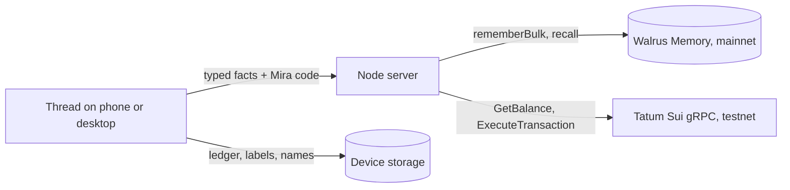

# Mira: the money friend you text

> A **Track 3 (Consumer Finance Apps)** entry to the Walrus × Tatum "Total Recall" hackathon. Start at
> [docs/prd.md](docs/prd.md); decisions are in [docs/adr/](docs/adr/README.md).

**Live:** https://mira-flax.vercel.app (chat at `/#/chat`). The web app is on Vercel and the API on
Railway ([ADR-0008](docs/adr/0008-web-on-vercel-api-on-railway.md)). Memory on Walrus mainnet, test money on
Sui testnet.

You text Mira what you spend, the way you'd text a friend: "coffee 5.5", "uber 18", "dinner 84 split 3
ways". She keeps your budget, your caps and your savings goal. Ask "should I buy the $48 serum?" and she
checks three stores, your caps, your goal's pace and **what she learned from your last answers**, then
offers "skip it, move $41 to Tokyo". One tap moves the money between your pockets. It feels like texting;
the blockchain stays out of sight.

## How Mira learns, and where it lives

| You do                                  | Mira writes to Walrus Memory (mainnet)          | What changes next time                                 |
| --------------------------------------- | ----------------------------------------------- | ------------------------------------------------------ |
| "budget 400 a month"                    | `BUDGET · monthly · about $400`                 | "left" on every receipt, the verdict on every ask      |
| "saving 1200 for tokyo by march"        | `GOAL · trip · about $1,200 · by 2027-03`       | where skip-and-save money goes; the greeting          |
| "cap eating out at 60 a week"           | `CAP · eating out · about $60 a week`           | cap meters, "skip it" when a buy would break it        |
| "coffee counts as eating out"           | `RULE · coffee → eating out`                    | the next coffee is filed there, "from memory"          |
| skip a $41 serum                        | `NUDGE · beauty · about $40 · skipped`          | beauty is flagged from $30, and Mira says why          |
| buy past a nudge twice                  | `NUDGE · shopping · … · bought anyway`          | the threshold rises; Mira nags less                    |
| spend through the month                 | `MONTH · 2026-11 · spent about $250`            | a new device knows where the month stands              |

- **The device keeps the numbers; memory keeps the lessons.** Exact spends, labels ("tokyo") and friends'
  names never leave the phone. The server builds every memory line from a typed fact, rounded
  ([ADR-0003](docs/adr/0003-ledger-on-device-typed-lines-in-memory.md)).
- **Memory follows you.** "Continue on my phone" shows a QR with your Mira code. The phone has an empty
  ledger, recalls your four namespaces from Walrus Memory and picks up where you left off.
- **Money moves on Sui testnet, through Tatum.** Spending and goal pockets are testnet addresses whose keys
  the server derives from a secret; the operator sponsors gas, so a $41 move moves exactly $41. Every
  balance read and move is a Tatum gRPC call, counted on the "Under the hood" panel
  ([ADR-0004](docs/adr/0004-mira-cash-pockets-on-sui-testnet.md)).

## Run it

Needs Node ≥ 22.18 (the server and packages are TypeScript that Node runs as is).

```bash
npm install && npm --prefix web install
npm run build:web
npm start
```

Open http://localhost:8787 (landing) and http://localhost:8787/#/chat. Without keys the server runs in
**preview mode**: memory on the SDK's in-process mock, pockets on a simulated ledger, and the header says
"preview" ([ADR-0006](docs/adr/0006-typescript-server-and-preview-mode.md)). For live mode, copy
`.env.example` to `.env` and fill in the Walrus Memory account and delegate key, the Tatum testnet key,
an operator testnet key (`npm run cash:faucet` tops it up) and a wallet secret.

For development: `npm run dev` (server with `--watch` plus Vite on http://localhost:5173, proxying `/api`).

## Architecture



| Path                       | Job                                                                                      |
| -------------------------- | ---------------------------------------------------------------------------------------- |
| `packages/money`           | Pure money logic: parse, categorise, ledger math, `adviseBuy`, facts and lines, `learn`  |
| `packages/memory`          | Walrus Memory: client, namespaces, rate limiter, redaction                               |
| `packages/chain`           | Tatum Sui gRPC client: pacing, metering, 402 fallback                                    |
| `server/src`               | API: memory write queue and recall, pockets and moves, health, static files              |
| `web/src/chat/useMira.ts`  | The agent: one message → one intent → a small plan, with a visible step trace            |
| `web/src/chat/Chat.tsx`    | The iMessage-style thread and its cards                                                  |

## Deploy

`vercel deploy --prod` from the repo root (the web app; `vercel.json` rewrites `/api/*` to Railway) and
`railway up --service mira` (the API, reading its keys from Railway variables).

## Tests

```bash
npm run typecheck && npm test   # money logic, memory queue, pockets, env, chain, memory packages
npm run e2e                     # the happy path in Chromium, preview mode, with a second device
npm run docs:links && npm run secrets:history
```

`npm run e2e` never writes to mainnet or testnet: it forces preview mode.

## Notes

- Stores and prices in the "should I buy" check are fictional (`web/src/data/catalog.ts`).
- Mira Cash is test money: $1 is 0.001 testnet SUI. Nothing here touches real money.
- The YouCam skin and try-on flows this fork started from live on in
  [upstream](https://github.com/harrymove-ctrl/mira-imessage); [DEVPOST.md](docs/DEVPOST.md) keeps that
  history.
