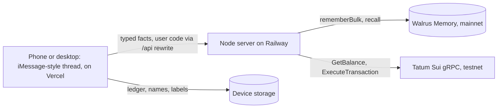

# Mira — Product Requirements (Track 3: Consumer Finance Apps)

- **Status:** Draft 1, 2026-11-03 ([ADR-0002](adr/0002-mira-becomes-a-money-friend.md))
- **Deadline:** Nov 10, 2026, 17:00 UTC ([event rules](event-rules.md))
- **Requirement IDs** (`F1`…) go at the start of commit messages.

## 0. Summary

**Mira is the money friend you text.** You tell her what you spend the way you'd text a friend ("coffee
5.5", "uber 18"). She keeps your budget, your caps and your savings goal, and when you ask "should I buy
the $48 serum?" she answers from what she has learned about you: your caps, your goal's pace, and how her
last nudges went. When you skip a buy, she moves that money into your goal with one tap. It feels like
Venmo, and the blockchain stays out of sight.

What makes it Track 3 and Walrus Memory:

- **She learns, and you can see it.** Every correction, cap, goal and nudge outcome becomes one short,
  typed line in Walrus Memory on mainnet. Those lines change what Mira does next: how a spend is
  categorised, which buys she flags, what she says when you come back.
- **Memory follows you, your ledger doesn't.** Exact amounts and names stay on the device. Open Mira on a
  new phone and she still knows your budget, caps, goal, rules and habits, because she recalls them from
  Walrus Memory.
- **Money moves for real, on Sui testnet.** Each user has pockets ("Spending", "Trip") backed by testnet
  addresses. Every balance read and every move goes through Tatum's Sui gRPC gateway. Gas is sponsored, so
  amounts are exact and nobody holds SUI.

## 1. Background

### 1.1 The track

Track 3 asks for "money products people actually open: shared budgets, spend tracking, savings goals, and
payment flows that feel normal. Blockchain stays invisible. Walrus Memory makes balances, habits and
preferences stick across sessions." Best Walrus Memory goes to the deepest learning loop: memories that
visibly change the product.

### 1.2 The problem

- Budgeting apps ask you to categorise and review. People stop opening them after two weeks.
- The moment that matters is **before** a purchase, and no app is there. A friend who knows your goal is.
- Assistants that "remember" usually keep everything, including what they shouldn't. A money app can't
  write your balances and names into an append-only store.

### 1.3 What we start from

Mira already has an iMessage-style thread with typing, chips, cards and a visible step trace, an agent
hook that runs small plans, and a Railway deploy. The YouCam beauty flows leave the product
(ADR-0002); the thread, the trace and the price check stay.

## 2. Goals, non-goals, success metrics

### 2.1 Goals

1. Spend tracking by text that takes under five seconds a spend.
2. A "should I buy" answer that cites what Mira learned, with a one-tap "skip and save".
3. A learning loop a judge can watch: correct once, and the next spend is right; skip once, and the next
   similar buy is flagged earlier; open a new device, and Mira still knows you.
4. Payments that feel normal: pockets, a "Moved ✓" receipt, no wallet, no gas, no seed phrase.

### 2.2 Judging map

| Criterion (weight)              | How Mira answers it                                                                           |
| ------------------------------- | --------------------------------------------------------------------------------------------- |
| Walrus + Tatum integration (30%) | Typed memory lines on mainnet drive four product behaviours (§8); Tatum gRPC for every Sui call |
| Technical quality (30%)          | Pure, tested money logic; server-built memory lines; paced, metered Tatum client; E2E test      |
| Creativity (20%)                 | A friend in your messages who talks you out of buys and banks the difference                   |
| Presentation (20%)               | The thread shows each step, the memory card shows each line with its Walrus blob              |

### 2.3 Non-goals

- Real money, bank links, card feeds or mainnet Sui. Testnet SUI stands in for dollars (§9).
- An LLM. The agent is deterministic: a parser, pure rules and the user's memory. Nothing acts alone.
- Deleting memories. Walrus Memory can't, so we never write what would need deleting (§8.2).
- User-owned Walrus Memory accounts. The operator's account holds every user's lines, namespaced per user.

### 2.4 Success metrics (by Nov 9)

- The happy path (§5) runs end to end on the deployed app with Walrus Memory on mainnet and Tatum on Sui
  testnet.
- At least 10 memories on mainnet from real use, every one of them a typed line from §8.1.
- `npm run e2e` passes on the happy path, including a second device that restores from memory.

## 3. Users

People in their twenties who spend by phone, save for one thing at a time (a trip, a laptop, a cushion),
and already talk to friends about money in their messages. They don't want a dashboard. They want someone
to ask before they buy.

## 4. Principles

1. **Text first.** Every action is a message or a chip. Cards show state; they never need a form.
2. **Explain with memory.** When Mira uses something she learned, she says so ("you skipped a $48 beauty
   buy last time, so I flag those from $40").
3. **The device keeps the numbers, memory keeps the lessons.** Exact spends and names never leave the
   device. Memory gets rounded, typed conclusions.
4. **Never block a reply on a write.** Writes take about 24 s. The reply comes first, the memory card shows
   the line as "saving" until its blob lands.
5. **Blockchain stays invisible.** Pockets and receipts, never addresses, unless you tap "receipt".

## 5. Happy path

1. **Open the thread.** Mira: "hey, I'm Mira 💸 text me what you spend like you'd text a friend." Chips:
   set a budget, start a goal, log a spend.
2. **"budget 400 a month"** → budget card. Memory: `BUDGET · monthly · about $400`.
3. **"saving 1200 for tokyo by march"** → goal card, "Trip" pocket opened, $100 test cash in Spending.
   Memory: `GOAL · trip · about $1,200 · by 2027-03`.
4. **"cap eating out at 60 a week"** → Memory: `CAP · eating out · about $60 a week`.
5. **Log spends:** "coffee 5.5", "uber 18", "ramen 24". Each is a one-line receipt with its category and
   what's left.
6. **Correct one:** "coffee counts as eating out". Mira re-files it. Memory: `RULE · coffee → eating out`.
   The next "coffee 4" goes straight to eating out, counts against the eating-out cap, and the receipt
   says "from memory".
7. **Ask:** "should I buy the $48 serum?" → Mira finds it for $41 at the cheapest store, checks the beauty
   cap, the budget and the trip's pace, and says "think twice". Chip: "Skip it, move $41 to Trip".
8. **Skip and save:** one tap → "Moved $41 to Trip ✓", Trip ring grows. Under the hood: a sponsored Sui
   testnet transfer through Tatum. Memory: `NUDGE · beauty · about $40 · skipped`.
9. **Ask again:** "thinking about a $38 lipstick" → flagged at $38 now, with the reason from memory.
10. **"what do you know about me?"** → the memory card: every line, its kind, and a link to its Walrus
    blob.
11. **New device:** "Continue on my phone" shows a QR with the user's Mira code. On the phone, with an empty
    device ledger, Mira recalls from Walrus Memory and greets: "welcome back 👋 still saving for your trip?
    you're at $41 of $1,200." Budget, caps, rules, nudge threshold and pockets are all there.

## 6. Features and flows

### 6.1 Spend tracking by text

- One message, one spend: an amount and a label in either order ("coffee 5.5", "$18 uber", "spent 24 on
  ramen"). "dinner 84 split 3 ways" logs your share.
- **Category:** a learned rule first (from memory), then a built-in keyword list, then "other". The receipt
  says which one decided.
- **Corrections:** "coffee counts as eating out" or "that was groceries" (the last spend). A correction re-files the
  spend on the device and writes a `RULE` line if the keyword is in the keyword list.

### 6.2 Budget, caps, goals

- One monthly budget. Caps per category, per week or month. One active goal at a time in P0, from a fixed
  list of goal kinds (trip, laptop, emergency fund, gift, home, car, other); the user's own label ("tokyo")
  stays on the device.
- The budget card shows spent this month, left, and the top categories. The goal card shows the pocket's
  balance (read through Tatum), the target and the pace.

### 6.3 "Should I buy?"

- Price: the catalog's cheapest store when the item matches, else the user's price.
- Verdict, from pure rules (`adviseBuy`):
  - **skip** when it breaks the budget or the category cap;
  - **think** when it's at or above the nudge threshold for that category (for wants — treats, beauty,
    shopping, fun — $40 until Mira learns otherwise), or more than a quarter of the budget left;
  - **go** otherwise.
- Reasons are typed and rendered as a list; every reason that came from memory says so.
- **think** and **skip** offer "Skip it, move $X to <goal>" and "Buy anyway". Either answer writes a
  `NUDGE` line. "Buy anyway" also logs the spend.

### 6.4 Pockets and moves (Mira Cash)

- Pockets: Spending and one per goal. Each is a Sui testnet address derived from a server secret and the
  user's code, so the server keeps no key store (ADR-0004).
- A new user gets $100 of test cash in Spending when they start a goal.
- "move 20 to trip", or the skip-and-save chip, moves money between pockets: a sponsored transfer, then a
  receipt bubble with "Moved ✓" and a small "receipt" link to the testnet explorer.

### 6.5 What Mira knows

- "what do you know about me?" shows the memory card: each line, its kind, "saving…" or "on Walrus" with
  the blob link, and what it changes in the product.
- The header shows where memory lives: "Walrus Memory" when the server has an account, "memory preview"
  when it runs without one (local development and tests).

### 6.6 New device

- The user's Mira code is a random 128-bit id kept on the device. "Continue on my phone" shows it as a QR
  link. Opening that link on another device adopts the code, recalls every namespace and rebuilds the
  learned state, then reads the pockets.

## 7. Requirements

### 7.1 MVP (P0)

| ID  | Requirement                                                                                                          |
| --- | -------------------------------------------------------------------------------------------------------------------- |
| F1  | Parse a message into one typed intent (spend, budget, cap, goal, correct, ask, move, memory, summary, greet, unknown) |
| F2  | Log spends on the device; categorise from learned rules, then keywords; show the receipt with what's left            |
| F3  | Budget, caps and a goal, set by text, shown as cards                                                                 |
| F4  | Corrections re-file the spend and write a `RULE` line                                                                |
| F5  | "Should I buy" with the catalog price check, typed reasons and a verdict from `adviseBuy`                            |
| F6  | Skip and save, and "move X to goal": a sponsored Sui testnet transfer through Tatum, with a receipt                  |
| F7  | Server-built memory lines from typed facts only; redaction; per-user namespaces; a write queue that never blocks     |
| F8  | Recall on open: every namespace, retried on dropped results, newest line wins per key                                |
| F9  | The learned state changes the product: categories, nudge thresholds, greeting, cards on a new device                 |
| F10 | The memory card with each line's status and Walrus blob                                                              |
| F11 | Continue on another device by QR, restoring from memory                                                              |
| F12 | Preview mode without keys (memory mock, simulated pockets), clearly labelled; the E2E test runs in it                |
| F13 | Health shows memory mode, chain mode, Tatum calls by method and the fallback state                                   |

### 7.2 Later

| ID  | Requirement                                                                                     |
| --- | ----------------------------------------------------------------------------------------------- |
| F20 | Shared budgets: splits with friends who are on Mira, "who owes what", settle up between pockets |
| F21 | Subscriptions: recurring spends detected from the ledger, with learned limits                  |
| F22 | Habit lines from the ledger (`HABIT`, `PACE`) used in the greeting and the goal's forecast      |
| F23 | Prices in other currencies from Tatum's exchange-rate Data API                                  |
| F24 | User-owned Walrus Memory accounts through a delegate key per user                               |

## 8. Walrus Memory

The device does the math. **Memory holds the conclusions the product acts on,** one typed line per memory.
The server builds every line from a typed fact (`factLine`); no user text is ever written as it is.

### 8.1 What may be written

| Namespace            | Line                                                         | Changes in the product                         |
| -------------------- | ------------------------------------------------------------ | ---------------------------------------------- |
| `mira:prefs:<user>` | `BUDGET · monthly · about $400 · as_of=…`                    | Budget card and "left" on every receipt        |
| `mira:prefs:<user>` | `CAP · eating out · about $60 a week · as_of=…`              | Cap checks in `adviseBuy`, receipt warnings    |
| `mira:prefs:<user>` | `GOAL · trip · about $1,200 · by 2027-03 · as_of=…`          | Goal card, skip-and-save target, greeting      |
| `mira:prefs:<user>` | `MONTH · 2026-11 · spent about $250 · as_of=…`               | Month spent carried to a new device            |
| `mira:rules:<user>` | `RULE · coffee → eating out · as_of=…`                       | How the next spend is categorised              |
| `mira:nudges:<user>` | `NUDGE · beauty · about $40 · skipped · as_of=…`             | The learned nudge threshold for that category  |
| `mira:habits:<user>` | `HABIT · eating out · about $60 a week · fri sat · as_of=…`  | Greeting on peak days (P1, F22)                |

- **Amounts are rounded** (`about`): to $1 under $20, $5 under $100, $10 under $1,000, $50 above.
- **Keywords come from a fixed list** (about 120 merchant and item words), goal kinds from a fixed list,
  categories from a fixed list. A fact outside the lists is rejected before it reaches the queue.

### 8.2 What is never written

Names (friends, merchants outside the list, people in a goal's label), goal labels, exact amounts, exact
balances, addresses, digests, account numbers and free text from the user. `redactCredentials` runs on
every line as a second fence.

### 8.3 How lines are read

- On open, the server recalls each of the four namespaces with `limit: 50`, retries an empty result that
  reports `dropped_count > 0` (four tries, with backoff), and parses each line back into a fact.
- `learn(facts)` keeps the newest fact per key by `as_of` and derives the nudge thresholds:
  - a skip at about $X sets the category's threshold to 80% of $X, rounded down to $10 (a skipped $41
    serum flags beauty from $30);
  - two "buy anyway" answers at or above the threshold raise it to the larger amount rounded up to $10,
    plus $10.

### 8.4 Writes

- `POST /api/memory` validates the facts, builds the lines, and queues them; it answers at once.
- The writer sends up to 20 queued lines at a time with `rememberBulk` and an idempotency key, waits for
  the jobs, and resubmits a failed line up to three times. One limiter per delegate key.
- The device keeps every fact it sent until its line reports a blob id, and resends it if the server lost
  it, so a line Mira said she saved survives a server restart.

### 8.5 The account

The team's existing Walrus Memory account on mainnet, shared with another app, with one delegate key on the
server ([ADR-0007](adr/0007-shared-memory-account-and-tatum-key.md)). Mira's namespaces carry a `mira:`
prefix. Test runs use the memory preview (`MemWalMock`) and never write to mainnet.

## 9. Sui and Tatum

- **Every Sui call goes through `@mira/chain`**: Tatum's native gRPC gateway on testnet, paced at 3 calls a
  second, counted per method, with the public fullnode as the fallback only while Tatum answers 402.
- **Calls used:** `GetBalance` (pocket balances), `ListOwnedObjects` and `SimulateTransaction` (building a
  transfer), `ExecuteTransaction`, `GetTransaction` (waiting for the result).
- **Units:** $1 of Mira Cash is 0.001 testnet SUI (1,000,000 MIST). The UI says "test money".
- **Gas:** the operator's testnet key sponsors every move, so a $41 move moves exactly $41.
- **No polling:** balances are read on open and after a move, never on a timer.

## 10. Architecture

| Path                          | Job                                                                         |
| ----------------------------- | --------------------------------------------------------------------------- |
| `packages/money`              | Pure money logic: parse, categorise, ledger math, advise, facts, lines, learn |
| `packages/memory`             | Walrus Memory: client, namespaces, limiter, redaction                       |
| `packages/chain`              | Tatum Sui gRPC client: pacing, metering, fallback                           |
| `server/src`                  | HTTP API: memory queue and recall, pockets and moves, health, static files  |
| `web/src/chat/useMira.ts`     | The agent: intents to plans, the trace, device state                        |
| `web/src/chat/Chat.tsx`       | The thread and its cards                                                    |

## 11. Safety and privacy

- The relayer sees plaintext and memories can't be deleted: §8.2 is enforced in code, not by convention.
- The Mira code is a bearer secret for test money and rounded lines. Anyone holding it can read those
  lines and move that test money between that user's own pockets, nothing more.
- Recalled lines are parsed into typed facts; a line that doesn't parse is dropped. Nothing recalled is
  ever executed or shown as an instruction.
- Seeding test cash is capped per server process per hour, so a script can't drain the operator.
- Keys live in the server's environment only. The repo is public; `npm run secrets:history` runs before
  every push.

## 12. Plan to the deadline

| Day    | Work                                                                                                   |
| ------ | ------------------------------------------------------------------------------------------------------ |
| Nov 3  | PRD, ADRs, P0 in preview mode, E2E green, testnet moves verified                                       |
| Nov 3  | Live smoke on the shared Tatum key and Walrus Memory account; first Railway deploy (ADR-0007)          |
| Nov 4–5 | Real use writes the first mainnet lines; fix what the live relayer shows                              |
| Nov 6–7 | P1 where it helps the demo (F20 splits, F22 habits); polish                                            |
| Nov 8  | Demo video (2–3 min) and blog post: what it does, Tatum and Walrus, how it learned                      |
| Nov 9  | Submission form: Tatum ID, Sui address, account ID and `MEMWAL_AGENT_ID` (see ADR-0007)                 |

## 13. The demo (2:30)

1. 0:00 The problem: budgeting apps you stop opening; the moment that matters is before you buy.
2. 0:20 Budget, goal and cap by text; three spends; a correction.
3. 0:55 "should I buy the $48 serum?", the reasons, skip and save, "Moved ✓".
4. 1:25 The next buy is flagged earlier, and Mira says why.
5. 1:45 "what do you know about me?", the lines and their Walrus blobs.
6. 2:00 Scan the QR, a new phone, Mira remembers. Tatum calls on the health panel.
7. 2:20 How it learned over time, in one sentence per memory kind.

## 14. Risks and open questions

| Risk                                        | Mitigation                                                              |
| ------------------------------------------- | ----------------------------------------------------------------------- |
| Relayer writes slow or failing              | Never block a reply; queue, bulk, resubmit; device keeps pending facts  |
| Empty recalls (`dropped_count`)             | Retry four times; device cache greets while recall runs                 |
| Testnet faucet limits the operator's funds  | $100 a user is 0.1 SUI; `npm run cash:faucet` tops up; seeding capped    |
| Tatum credits                               | No polling; balances on open and after a move; usage on health          |
| A judge sees "test money" as fake           | Say it plainly: testnet stands in for USDC; the flows are the product   |

Open: whether splits (F20) make the demo, and whether habits (F22) need a week of real data to look honest.
